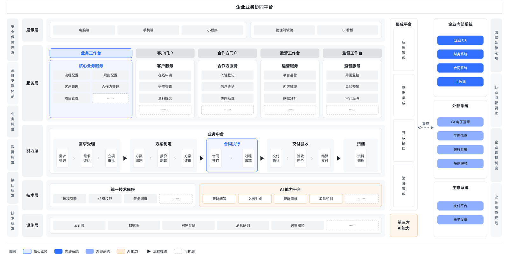
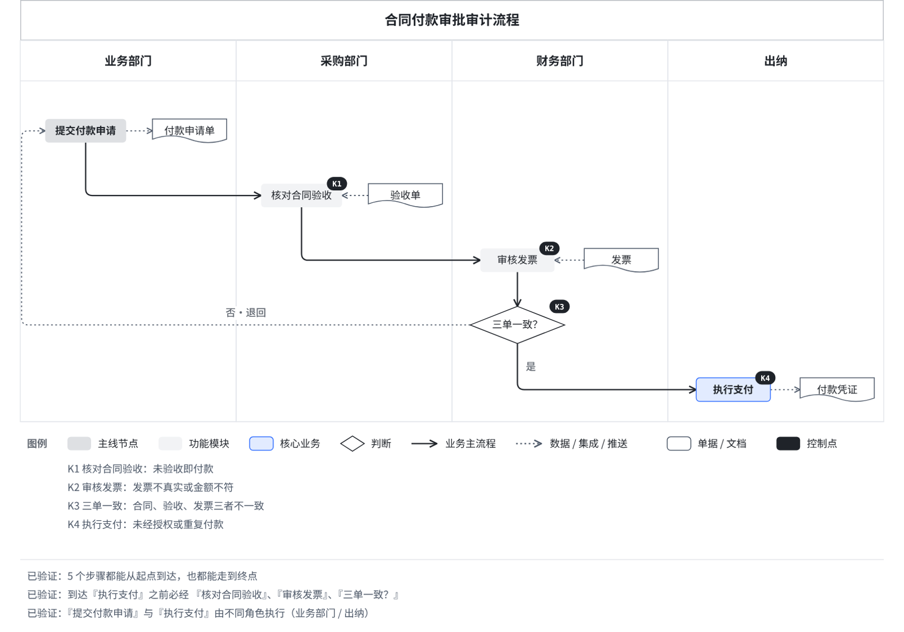

# Saan Diagram

把业务描述、需求文档、白板截图，转成同一套规范下的中文业务图示。

> **统一的是约束语言，不是具体方案。** 不同项目画的内容可以不同，但阶段、节点类型、线型、配色和校验规则都是同一套。

Saan Diagram 是一个 Claude Skill。模型只写一份 YAML spec，用阶段、泳道、行来定位，不写像素也不写颜色；坐标、走线、配色、字号和图例都由 `render.py` 计算。`--lint` 不通过，就不能交付。

- **14 种图示**，共用一套视觉语法
- **49 条校验规则**，写在脚本里，不靠模型记忆；`--selftest` 证明每条规则都能被故意改坏的样例触发
- **业务发现不许被"修掉"**：失控点、绕过控制、数据黑洞、权限交叉等问题会原样报告，用户确认后写进图例
- **流程路径验证**：遍历流程图的所有路径，检查控制点不可绕过、岗位分离、没有死路
- **颜色只留给"系统"和"核心"**：业务节点一律中性灰，核心色全图不超过 3 处
- **交付方式由你选**：直接输出 HTML / SVG / PNG，或通过内置脚本安全写入飞书画板（不用飞书的人不会加载这部分说明）



## 支持的图示

| 你要表达的是 | 图示 | 写法 | 示例 |
|---|---|---|---|
| 各阶段有哪些模块，接哪些系统 | 架构视图 | `columns` + `nodes` + `edges` | [1-arch](skills/saan-diagram/assets/1-arch.yaml) |
| 一条主流程，含判断和回退 | 主流程视图 | `paths` | [2-flow](skills/saan-diagram/assets/2-flow.yaml) |
| 几种方式各走过哪些阶段 | 路径对比视图 | `paths` 多行 | [3-paths](skills/saan-diagram/assets/3-paths.yaml) |
| 多个角色之间的交接 | 泳道图 | `columns` = 角色 | [4-swim](skills/saan-diagram/assets/4-swim.yaml) |
| 数据从哪来、经过哪些处理、存到哪 | 数据流图 | `profile: dfd` | [bid-dfd](skills/saan-diagram/assets/bid-dfd.yaml) |
| 单据与关键控制点 | 审计流程图 | `profile: audit` | [payment-audit](skills/saan-diagram/assets/payment-audit.yaml) |
| 哪些环节不增值 | 机会流程图 | `profile: opportunity` | [vendor-opportunity](skills/saan-diagram/assets/vendor-opportunity.yaml) |
| 平台由哪些层组成、对外接什么 | 分层架构图 | `layout: layers` | [biz-platform](skills/saan-diagram/assets/biz-platform.yaml) |
| 业务对象及其关系、几对几 | 实体关系图 | `layout: er` | [procurement-er](skills/saan-diagram/assets/procurement-er.yaml) |
| 谁管谁，谁能看到谁的数据 | 组织架构图 + 数据隔离 | `layout: org` | [group-org](skills/saan-diagram/assets/group-org.yaml) |
| 一个结果背后有哪些原因 | 鱼骨图 | `layout: fishbone` | [bid-fishbone](skills/saan-diagram/assets/bid-fishbone.yaml) |
| 关键节点什么时候到、偏了多少 | 里程碑时间线 | `layout: timeline` | [platform-timeline](skills/saan-diagram/assets/platform-timeline.yaml) |
| 两个维度上该先做哪个 | 四象限图 | `layout: quadrant` | [ai-quadrant](skills/saan-diagram/assets/ai-quadrant.yaml) |
| 每个活动受什么约束、靠谁完成 | IDEF0 功能模型 | `layout: idef0` | [proc-idef0](skills/saan-diagram/assets/proc-idef0.yaml) |

时序交互、状态流转、物理表结构、按任务排期的甘特图不在范围内，建议用 Mermaid 或数据库建模工具。

## 安装

### Claude Code（插件市场）

```bash
/plugin marketplace add yishan/saan-diagram
/plugin install saan-diagram@saan-diagram
```

### Claude Code（手动）

把 `skills/saan-diagram/` 整个目录复制到 `~/.claude/skills/saan-diagram/`（个人）或项目里的 `.claude/skills/saan-diagram/`。

### Claude.ai

把 `skills/saan-diagram/` 目录打成 zip（zip 里的顶层是 `saan-diagram/` 文件夹），在 Claude.ai 的设置里上传为自定义 Skill。

## 依赖

| 用途 | 需要 |
|---|---|
| 校验与出 HTML / SVG | Python 3.9+、`pyyaml` |
| 导出 PNG | `playwright` + Chromium |
| 写入飞书画板 | [`lark-cli`](https://github.com/larksuite) 并已登录，Node.js（用于 `@larksuite/whiteboard-cli`） |

## 单独使用渲染脚本

```bash
cd skills/saan-diagram
pip install pyyaml
python3 scripts/render.py --init audit > pay.yaml     # 起步模板（14 种）
python3 scripts/render.py --guide verify              # 某类图的详细写法
python3 scripts/render.py pay.yaml --all              # 校验 + 路径验证 + HTML + PNG + 画板 DSL
python3 scripts/render.py --selftest                  # 自测：示例全部通过 + 每条规则都能失败
```

退出码：0 通过 · 1 有排版问题 · 2 只剩未确认的业务发现 · 3 spec 写错。

## 流程路径验证

```yaml
verify:
  must_pass:
    - {before: 执行支付, through: [核对合同验收, 审核发票, 三单一致？]}   # 控制点不可绕过
  separate:
    - [提交付款申请, 执行支付]                                          # 岗位分离
```

失败时给出业务语言的反例，例如"可以绕过『审核发票』到达『执行支付』：提交付款申请 → 紧急付款审批 → 执行支付"。这类问题属于业务发现，不能为了通过而删线；用户确认现状如此后写进 `accept`，图例下方会如实写明。



## 写入飞书画板

写入只能通过内置脚本，模型不直接拼 lark-cli 写入命令：

```bash
cd skills/saan-diagram
python3 scripts/wb_publish.py pay.wb.json --token <wbcn…>                # 先导出现有画板并停下（退出码 20）
python3 scripts/wb_publish.py pay.wb.json --token <wbcn…> --mode append  # 确认后写入，写后导出核验图
```

想把"只能通过脚本"变成硬限制，在 Claude Code 的 `.claude/settings.json` 里禁止直接调用写入命令（脚本内部调用不受影响）：

```json
{ "permissions": { "deny": ["Bash(lark-cli whiteboard +update *)", "Bash(lark-cli docs +update *)"] } }
```

## 视觉语法速览

| 元素 | 样式 |
|---|---|
| 主线节点 `hub` / 功能模块 `module` | 中性灰，深浅两档 |
| 内部系统 / 外部服务 `system` | VI 主色 / 主色提亮 45% |
| 核心业务 `core: true` | 主色浅底 + 主色描边，全图 ≤3 处 |
| 重点能力 `special` | 浅橙底，名称由 `special.label` 声明（如"AI 能力"） |
| 业务主流程 / 数据集成 / 配置依赖 | 实线 / 点线 / 紫色虚线 |
| 标题栏 | 默认白底线框，可选 `gray` / `brand` / `dark` |

完整规则见 [SKILL.md](skills/saan-diagram/SKILL.md)。

## 写飞书画板的规矩（写在脚本里）

- 不带 `--mode` 不写：先导出现有画板预览，退出码 20，看图后再决定追加还是覆盖
- 覆盖只在 `--mode overwrite` 时发生，必须有用户明确同意
- 不新建文档：只往用户给的画板或文档里写
- `lark-cli` 退出码 10 是高风险确认门禁，原样返回给用户确认，不自动追加参数
- 幂等 token 由内容哈希生成，重试自动复用

## 致谢

排版规则参考 [cathrynlavery/diagram-design](https://github.com/cathrynlavery/diagram-design)（图示类型选择、正交连线、标签留白、焦点色预算、4px 网格），并改成适合中文业务图的版本。

## 许可

[MIT](LICENSE) © 2026 Yishan。示例内容均为虚构。
