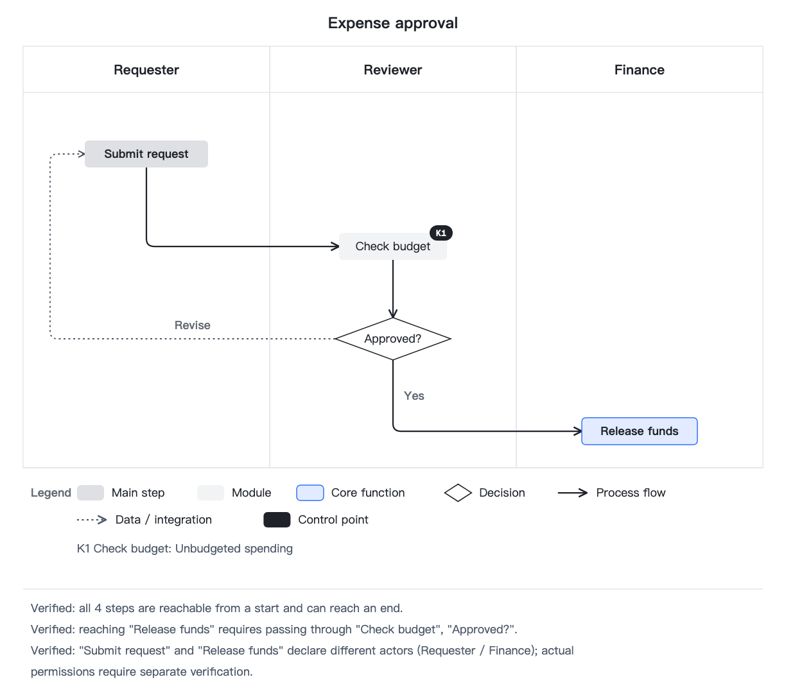

# Saan Diagram

**English** | [简体中文](README.zh-CN.md)

[Introduction & example gallery (中文)](https://saan-diagram.vercel.app/)

Turn business descriptions, requirements documents, and whiteboard screenshots into business diagrams in English or Chinese with a consistent visual language.

> **Standardize the rules, not the solution.** Each project can have different content while sharing the same stages, node types, line styles, colors, and validation rules.

Saan Diagram is an agent skill for Claude Code, Codex, and other compatible agents. The model writes a YAML spec using stages, lanes, and rows instead of pixel coordinates or colors. `render.py` calculates positions, routes, colors, typography, and legends. Diagrams must pass `--lint` before delivery.

- **14 diagram types** sharing one visual language.
- **50 validation rules** implemented in code. `--selftest` checks that deliberately broken examples trigger every rule.
- **Preserve business findings:** missing controls, bypass paths, data sinks, and conflicting responsibilities are reported as findings. Once the user confirms the current situation, the findings appear in the diagram legend.
- **Process path verification:** check reachability, control-point bypasses, separation of duties, and dead ends in the modeled process.
- **Reserve color for systems and core functions:** business nodes use neutral gray, with at most three core highlights per diagram.
- **Aligned elements, fewer bends:** connected nodes that are slightly off are lined up automatically, and auto-routed edges bend at most once; an edge that still needs two bends is reported (G5).
- **Choose your output:** HTML, SVG, PNG, or Feishu/Lark whiteboard publishing through the bundled script. Whiteboard instructions are loaded only when needed.

The canonical `SKILL.md` is in English. The agent follows the output language you specify, or the language of your request when you do not specify one. Chinese templates remain available alongside English examples.


## Supported diagrams

| What you need to show | Diagram | Spec structure | Example |
|---|---|---|---|
| Modules in each stage and the systems they connect to | Architecture view | `columns` + `nodes` + `edges` | [1-arch](skills/saan-diagram/assets/1-arch.yaml) |
| A main process with decisions and returns | Process flow | `paths` | [2-flow](skills/saan-diagram/assets/2-flow.yaml) |
| Different approaches across the same stages | Path comparison | Multiple `paths` rows | [3-paths](skills/saan-diagram/assets/3-paths.yaml) |
| Handoffs between roles | Swimlane diagram | Columns represent roles | [4-swim](skills/saan-diagram/assets/4-swim.yaml) |
| Where data comes from, how it is processed, and where it is stored | Data flow diagram | `profile: dfd` | [bid-dfd](skills/saan-diagram/assets/bid-dfd.yaml) |
| Documents and key controls | Audit flowchart | `profile: audit` | [payment-audit](skills/saan-diagram/assets/payment-audit.yaml) |
| Steps that do not add value | Opportunity flowchart | `profile: opportunity` | [vendor-opportunity](skills/saan-diagram/assets/vendor-opportunity.yaml) |
| Platform layers and external connections | Layered architecture | `layout: layers` | [biz-platform](skills/saan-diagram/assets/biz-platform.yaml) |
| Business entities, relationships, and cardinality | Entity relationship diagram | `layout: er` | [procurement-er](skills/saan-diagram/assets/procurement-er.yaml) |
| Reporting lines and declared data access boundaries | Organization chart with data isolation | `layout: org` | [group-org](skills/saan-diagram/assets/group-org.yaml) |
| Causes behind an outcome | Fishbone diagram | `layout: fishbone` | [bid-fishbone](skills/saan-diagram/assets/bid-fishbone.yaml) |
| Milestone dates and schedule variance | Milestone timeline | `layout: timeline` | [platform-timeline](skills/saan-diagram/assets/platform-timeline.yaml) |
| Priorities across two dimensions | Quadrant chart | `layout: quadrant` | [ai-quadrant](skills/saan-diagram/assets/ai-quadrant.yaml) |
| Inputs, controls, outputs, and mechanisms for each activity | IDEF0 function model | `layout: idef0` | [proc-idef0](skills/saan-diagram/assets/proc-idef0.yaml) |

Sequence diagrams, state machines, physical database schemas, and task-level Gantt charts are outside this skill's scope. Use tools such as Mermaid or a database modeling tool for those tasks.

## Installation

### skills CLI (Claude Code, Codex, and other agents)

```bash
# List discoverable skills without installing
npx skills add yishan/saan-diagram --list

# Install and select agents interactively; project-level installation is the default
npx skills add yishan/saan-diagram --skill saan-diagram

# Choose Claude Code or Codex explicitly; add -g for a user-level installation
npx skills add yishan/saan-diagram --skill saan-diagram -a claude-code
npx skills add yishan/saan-diagram --skill saan-diagram -a codex
```

Use a Node.js version supported by the current skills CLI. The CLI installs the complete skill directory; see the dependencies below (uv and a local Chrome are enough for most desktops).

The skills.sh directory and rankings are driven by CLI installation telemetry. Having an installation command does not establish that the skill is listed, and successful installation does not validate rendering or whiteboard publishing. See the [CLI documentation](https://github.com/vercel-labs/skills) and [listing FAQ](https://skills.sh/docs/faq).

### Claude Code plugin marketplace

```bash
/plugin marketplace add yishan/saan-diagram
/plugin install saan-diagram@saan-diagram
```

### Claude Code manual installation

Copy the entire `skills/saan-diagram/` directory to `~/.claude/skills/saan-diagram/` for personal use, or to `.claude/skills/saan-diagram/` in your project.

### Claude.ai

Zip the complete `skills/saan-diagram/` directory, keeping `saan-diagram/` as the top-level folder in the archive. Upload it as a custom skill in Claude.ai settings.

## Dependencies

| Purpose | Requirements |
|---|---|
| Validation and HTML/SVG output | Python 3.9+ and [uv](https://docs.astral.sh/uv/) (fetches `pyyaml` automatically); or `pip install -r requirements.txt` |
| PNG export | A local Chrome, Chromium, Edge, or Brave (headless screenshot; set `SAAN_CHROME` for non-default locations) |
| Feishu/Lark whiteboard publishing | An authenticated [`lark-cli`](https://github.com/larksuite), plus Node.js for `@larksuite/whiteboard-cli` |

## Standalone renderer

```bash
cd skills/saan-diagram
uv run scripts/render.py --init audit > pay.yaml     # Starter template (14 types)
uv run scripts/render.py --guide verify              # Detailed guide for a topic
uv run scripts/render.py pay.yaml --all              # Validate, verify paths, export HTML/PNG/whiteboard DSL
uv run scripts/render.py --selftest                  # Validate examples and exercise every rule
```

Exit codes: `0` requested operation succeeded · `1` layout issues · `2` unconfirmed business findings · `3` invalid spec · `4` failed or incomplete artifact generation.

Rendering also writes `<slug>.result.json` with the status of each artifact. Without uv, `pip install -r requirements.txt` once and replace `uv run` with `python3`. PNGs come from the system browser; in containers without one, install Chromium (running as root adds `--no-sandbox` automatically). A PNG export failure returns `4` while preserving successfully generated HTML and whiteboard DSL. Request HTML/SVG explicitly when PNG is not needed. Use `--result-json PATH` to choose a result file; this option also provides machine-readable results with `--lint`.

## Output language

The agent uses your explicitly requested output language; otherwise it follows the language of your request. The language of the skill instructions or starter template does not override your choice.

```yaml
language: en  # en or zh-CN
```

`--language en` overrides the spec for renderer-generated captions. The renderer does not translate input labels, names, or notes; the agent adapts those while preserving identifiers and references. Existing specs without `language` retain Chinese captions. Generated legends, business findings, and verification annotations support both locales; detailed guides and some CLI diagnostics remain in Chinese.

English examples: [approval flow](skills/saan-diagram/assets/en/approval-flow.yaml), [layered architecture](skills/saan-diagram/assets/en/platform-layers.yaml), and [release timeline](skills/saan-diagram/assets/en/release-timeline.yaml).

```bash
cd skills/saan-diagram
uv run scripts/render.py assets/en/approval-flow.yaml --all --outdir out
```

Quote YAML labels such as `"Yes"`, `"No"`, `"On"`, and `"Off"` so the YAML parser does not treat them as booleans. English labels wrap at word boundaries. Keep technical identifiers intact and shorten long labels without losing their meaning.



## Process path verification

```yaml
verify:
  must_pass:
    - {before: 执行支付, through: [核对合同验收, 审核发票, 三单一致？]}   # Required controls before payment
  separate:
    - [提交付款申请, 执行支付]                                      # Separation of duties
```

Failures include a counterexample in business terms, such as: “Payment can be reached without invoice review: submit payment request → emergency payment approval → execute payment.” These are business findings. Do not delete edges just to pass validation. If the user confirms that this is the current process, record the finding in `accept`; it will appear below the legend.


## Publish to a Feishu/Lark whiteboard

Use the bundled publisher instead of constructing write commands directly:

```bash
cd skills/saan-diagram
python3 scripts/wb_publish.py pay.wb.json --token <wbcn…>                # Export the existing board and stop (exit 20)
python3 scripts/wb_publish.py pay.wb.json --token <wbcn…> --mode append  # After confirmation, write and export for review
```

If the write succeeds but the verification image cannot be exported, the script returns `21`. Retry only the readback to avoid another write:

```bash
python3 scripts/wb_publish.py pay.wb.json --token <wbcn…> --verify-only
```

Publishing results are saved to `<slug>.wb.publish.json`. Successful readback and visual inspection are separate states. The only permitted passthrough is `--pass=--yes`, when required by the confirmation gate and authorized by the user. Passthrough arguments cannot change the target, source, or write mode.

## Visual language

| Element | Style |
|---|---|
| Main-process node `hub` / functional module `module` | Two shades of neutral gray |
| Internal system / external service `system` | Brand color / brand color lightened by 45% |
| Core business function `core: true` | Light brand background and brand border; at most 3 per diagram |
| Highlighted capability `special` | Light orange; category named by `special.label`, such as “AI capabilities” |
| Business flow / data integration / configuration dependency | Solid / dotted / purple dashed line |
| Title bar | Borderless by default; optional `outline`, `gray`, `brand`, or `dark` |

See [SKILL.md](skills/saan-diagram/SKILL.md) for the canonical instructions, or the [Chinese reading version](docs/SKILL.zh-CN.md).

## Whiteboard publishing safeguards

- Without `--mode`, no write occurs. The script exports the existing board and exits with `20`. Review the image before choosing append or overwrite.
- Overwriting requires `--mode overwrite` and explicit user approval.
- The publisher does not create documents. It writes only to the board or document supplied by the user.
- A `lark-cli` exit code of `10` is a high-risk confirmation gate. It is returned for user confirmation; arguments are not added automatically.
- The idempotency token includes the target, write mode, and content, and is reused on retries.

## Development and validation

`guides/*.md` and `assets/*.yaml` are the authoritative guide and example sources. The renderer reads these files directly instead of maintaining embedded copies. Distribute and install the complete `skills/saan-diagram/` directory. Input validation lives in `scripts/spec_validation.py`; the renderer has one CLI entry point.

Run from the repository root:

The tests import the renderer directly, so install PyYAML first (`python3 -m pip install -r skills/saan-diagram/requirements.txt`) or prefix each command with `uv run --with pyyaml`.

```bash
uv run skills/saan-diagram/scripts/render.py --selftest
python3 -m unittest discover -s tests -v
python3 scripts/render_smoke.py            # Validate 14 original + 3 English examples and their SVG/whiteboard DSL output
python3 scripts/render_smoke.py --png      # Also export PNGs with the local Chrome
```

GitHub Actions runs a Python version matrix, behavioral regression tests, and browser export checks. The self-test's 50/50 count measures rule-trigger coverage, not complete branch coverage, visual correctness, or actual business permissions. Whiteboard publishing tests use mocked subprocesses and do not access user boards.

### Upgrading from v1.2

- PNG export uses the local Chrome, Chromium, Edge, or Brave in headless mode. Playwright and `requirements-png.txt` are no longer needed; set `SAAN_CHROME` when the browser is in a non-default location.
- `render.py` declares PyYAML inline, so `uv run scripts/render.py …` needs no virtual environment. `pip install -r requirements.txt` with `python3` still works. Existing virtual environments and Playwright browser caches can be removed.
- The title bar is now borderless by default (`titlebar: plain`). Set `titlebar: outline` to keep the previous white bar with a 1px border.
- Connected free nodes that are less than half a lane or row apart are aligned before routing; set `align: false` to keep the declared positions. Diagonal neighbors get a single-bend route when the path is clear.
- New rule **G5**: an auto-routed edge that still bends twice fails lint. Put connected nodes in the same `lane` or `row`, or set `route` explicitly for intentional detours such as return loops. `--selftest` now checks 50 rule triggers.

### Upgrading from v1.1

- The skill entry point and plugin discovery descriptions are now in English, with explicit output-language precedence.
- Set `language: en` for English captions. Existing Chinese specs retain their default behavior.
- English wrapping preserves words. Capability chips and architecture rails account for Latin text width.
- `--selftest` still checks the 14 original templates and 49 rule triggers. Regression tests check both locales across all 14 diagram types; smoke rendering also includes 3 realistic English examples.

### Upgrading from v1.0

- `verify: {}` now enables verification. Disconnected business steps may produce new findings. For mixed diagrams, use `verify.nodes` to declare the scope and explain exclusions.
- Separation of duties requires node-level `actor` values or `column_semantics: roles`. Business stages do not imply roles.
- Timeline completion is explicitly declared with `status: done | pending | unknown`. Omitted status means unknown.
- Missing PNG output no longer returns `0` for a complete delivery. Failed readback after a write returns `21`.
- Installing only `render.py` is no longer supported. Install the complete skill directory.

## Introduction page

The static introduction page lives in [`page/`](page/README.md) and is hosted on Vercel. The Vercel project uses `page` as its Root Directory and `main` as its production branch. No build step is required.

Run `python3 scripts/sync_page.py` after updating the skill examples or preview images to refresh the page's 14 embedded specs, images, and version label.

## Acknowledgments

Layout rules draw on [cathrynlavery/diagram-design](https://github.com/cathrynlavery/diagram-design): diagram selection, orthogonal connectors, label spacing, accent-color budgets, and a 4 px grid. They have been adapted for business diagrams in English and Chinese.

## License

[MIT](LICENSE) © 2026 Yishan. All example content is fictional.
