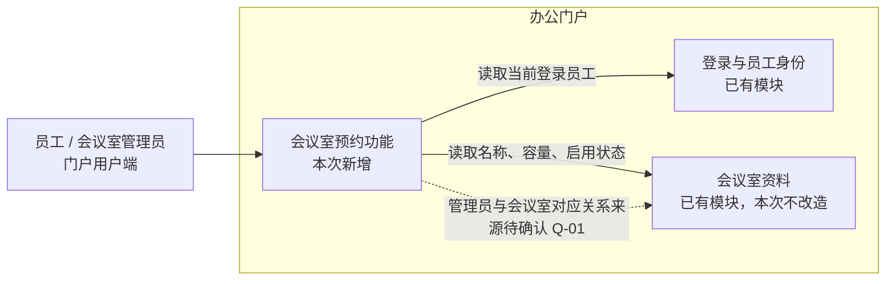
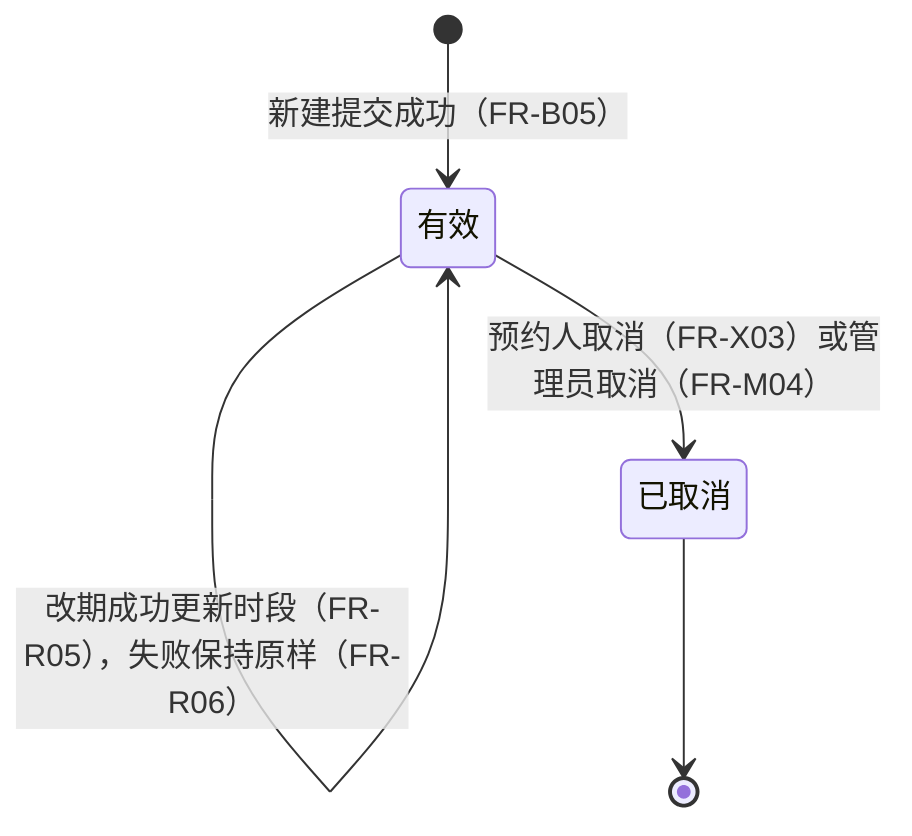

# 会议室预约与改期需求规格说明书

> 虚构验证材料。本文所有业务数据、人员和会议室均为虚构，不对应任何真实系统。

## 文档控制

| 项目 | 内容 |
|---|---|
| 文件标识 | 待按项目文档编号规则指定 |
| 当前版本 | V0.1 |
| 文件状态 | 草稿（未评审） |
| 作者 | 待指定（本稿依据 S-01、S-02 及调研底稿 D-01 起草） |
| 完成／更新日期 | 2026-11-05 |
| 适用范围 | 办公门户新增的会议室占用查看、单次预约、改期与取消；单一办公点 |

### 版本历史

| 修订日期 | 版本 | 修订内容 | 修订人 | 备注 |
|---|---|---|---|---|
| 2026-11-05 | V0.1 | 初稿：第 1—6 章、验收检查、待确认事项 | 待指定 | 供产品、研发、测试评审；未经补问，待确认事项见附录 B |

### 目录

1. 引言
2. 项目概况
3. 系统概述
4. 功能需求
5. 非功能需求
6. 总体设计约束

附录 A. 验收检查
附录 B. 待确认事项与决策
附录 C. 来源处理与评审记录

## 1. 引言

### 1.1 文档范围

本文定义办公门户中会议室预约功能的需求，覆盖：

- 员工查看所有会议室的占用时段；
- 员工为自己创建单次预约；
- 预约人改期、取消自己的预约；
- 会议室管理员取消其所管会议室中的预约；
- 取消操作的记录。

以下内容不在本次范围（S-01 §背景、§其他资料；S-02 §明确结论 1、2）：

- 跨办公点预约、周期预约、参会人邀请、签到、收费；
- 会议室资料管理（名称、容量、启用状态的维护）；
- 预约审批；
- 使用情况统计（后续规划，本期不做）；
- 管理员替员工改期。

确认状态：第 4 章中标注来源的规则来自需求简报 S-01 与评审记录 S-02。标注「〔建议〕」的界面元素和文案是本稿提出的建议，尚未确认。提前量、可预约天数、人均上限、停用会议室存量预约、取消记录保存与查看、通知等事项尚无结论，集中列于附录 B，正文不为其填值。

### 1.2 读者对象

| 读者 | 阅读目的 |
|---|---|
| 产品负责人、行政负责人 | 核对业务规则、权限与待决事项，作出附录 B 中的决策 |
| 研发人员 | 理解功能边界、数据效果与提交处理时的校验要求 |
| 测试人员 | 依据功能约束与附录 A 设计验收用例 |
| 门户及会议室资料模块负责人 | 核对对已有模块（登录、员工身份、会议室资料）的依赖 |

### 1.3 术语、缩写与名词解释

| 术语 | 缩写 | 解释 |
|---|---|---|
| 预约 | — | 员工对一间会议室、一个日期内一个时段的单次占用申请。由当前登录员工创建。 |
| 有效预约 | — | 提交成功且未被取消的预约。提交符合条件且无冲突即成为有效预约，无审批环节（S-02）。材料未定义「已结束」等其他业务状态（Q-21）。 |
| 「已取消」 | — | 预约被预约人或管理员取消后的状态，界面文案已确认（S-01 §7；S-02）。 |
| 占用区间 | — | 预约的 [开始时间, 结束时间)，左闭右开（S-01 §3）。 |
| 冲突 | — | 同一会议室的两个有效预约的占用区间有交集（S-01 §3、§4；跨会议室含义见 Q-13）。 |
| 尚未开始／已经开始 | — | 以预约开始时间与提交处理时的当前时间比较。恰好等于开始时刻的归属待确认（Q-07）。 |
| 预约人 | — | 预约的创建人，即创建时的当前登录员工。 |
| 会议室管理员 | — | 负责某间会议室的管理员。管理员与会议室的对应关系来源未确认（Q-01）。 |
| 「已占用」 | — | 非预约人、非该会议室管理员查看占用时段时看到的显示文案，已确认（S-01 §8；S-02）。 |
| 半小时刻度 | — | 时间的分钟数为 00 或 30。 |
| 提交处理时 | — | 系统收到新建、改期、取消请求并处理的时刻；相关校验在此时执行，不只依靠前端按钮状态（S-02 §明确结论 4）。 |

### 1.4 参考文档

| 编号 | 文档／来源 | 版本或日期 | 对应范围 | 链接／位置 |
|---|---|---|---|---|
| S-01 | 办公会议室预约｜需求简报 | 2026-11-02 | 背景、范围、业务条件 1—11、其他资料 | input/brief.md |
| S-02 | 预约功能评审记录 | 2026-11-03 | 明确结论 4 条；尚无结论的意见 | input/review-notes.md |
| D-01 | 办公会议室预约｜调研底稿 | 未标注日期 | 对 S-01、S-02 的整理、冲突与缺口清单（Q-01—Q-18） | input/discovery-room-booking.md |

来源优先级：S-01 写明是否审批“以评审结论为准”，S-02 确认即时占用、无审批，本文采用 S-02。D-01 是对 S-01、S-02 的二次整理，不是独立需求来源；本文规则均回溯到 S-01、S-02 原文，D-01 的推导项单独标注。

## 2. 项目概况

### 2.1 项目背景

某办公点有多间会议室。目前员工在群里询问会议室是否空闲，由行政人员手工登记。两名员工可能先后看到同一个空闲时段，在行政登记前无法判断谁最终预约成功（S-01 §背景）。

本次在已有办公门户中加入会议室空闲查看、单次预约、改期和取消。员工身份、登录和会议室资料复用门户已有模块。

材料没有提供冲突频率、行政登记耗时等数据。现状问题只有定性描述，本文不写入量化收益。

### 2.2 项目目标

| 目标 | 判断方法 | 状态 |
|---|---|---|
| 员工可自助查看占用并即时得到预约结果，不再依赖行政手工登记 | 提交后立即得到成功或冲突结果（FR-C05、FR-B05） | 规则已确认 |
| 同一会议室同一时段不出现两个有效预约 | 并发提交最多一个成功（FR-C05）；附录 A AC-08 | 规则已确认 |
| 预约人能自助改期、取消；管理员能处理所管会议室的预约 | 4.2.3、4.2.4、4.3.1 | 规则已确认 |
| 量化改善指标（如行政工作量、冲突次数） | 缺少基线与统计口径 | 待确认，本期不设指标 |

## 3. 系统概述

### 3.1 系统应用架构

- 预约功能是门户内新增部分，负责占用查看、预约、改期、取消及取消记录。
- 登录与员工身份沿用门户已有机制。预约功能从中取得当前登录员工，作为创建人和操作人。
- 会议室资料（名称、容量、启用状态）来自已有模块。本次不改造该模块的资料管理。
- 管理员与会议室的对应关系在现有会议室资料中未列出（Q-01）。若需新增，可能涉及不在本次范围的会议室资料模块，需先决策。
- 门户技术栈、部署方式、通知能力均未提供（Q-10、Q-17）。本文不指定技术方案。

### 3.2 业务整体框架

预约状态与流转：

- 改期、取消仅适用于尚未开始的有效预约。已经开始的预约保持原状，不能改期或取消（FR-R02、FR-X02、FR-M02）。
- 「已取消」为终态，不能再改期或取消（FR-X05）。
- 有效预约在开始或结束后是否展示为其他状态，材料未定义（Q-21）。

角色协作：

| 环节 | 员工（预约人） | 会议室管理员 | 系统 |
|---|---|---|---|
| 查看占用 | 查看所有会议室占用；本人预约显示主题 | 所管会议室的预约显示主题 | 按 FR-V02 控制主题可见性 |
| 新建预约 | 为自己提交 | 为自己提交，同员工规则 | 提交处理时校验，成功即生效 |
| 改期 | 改期本人尚未开始的有效预约 | 只能改期本人预约；不能改期他人预约 | 校验目标；失败不影响原预约 |
| 取消 | 取消本人尚未开始的有效预约 | 取消所管会议室中尚未开始的有效预约，填写原因 | 状态变为「已取消」，释放占用，保存取消记录 |
| 通知 | — | — | 待确认（Q-10） |

### 3.3 功能清单

| 序号 | 一级功能 | 二级功能 | 三级功能 | 功能描述 | 详情编号 |
|---|---|---|---|---|---|
| 0 | 会议室预约 | 通用规则 | 时间、冲突、并发与校验时机 | 新建与改期共用的时间与冲突规则 | 4.0 |
| 1 | 会议室预约 | 会议室占用 | 查看会议室占用 | 员工查看所有会议室占用时段，按角色控制主题可见性 | 4.1.1 |
| 2 | 会议室预约 | 预约管理 | 新建预约 | 当前登录员工为自己预约一间会议室的一个时段 | 4.2.1 |
| 3 | 会议室预约 | 预约管理 | 我的预约 | 员工查看本人创建的预约，含「已取消」记录 | 4.2.2 |
| 4 | 会议室预约 | 预约管理 | 改期 | 预约人更换本人预约的会议室、日期或时段 | 4.2.3 |
| 5 | 会议室预约 | 预约管理 | 取消预约 | 预约人取消本人预约 | 4.2.4 |
| 6 | 会议室预约 | 会议室管理员操作 | 管理员取消预约 | 管理员在所管会议室的占用记录中取消他人预约并填写原因 | 4.3.1 |

## 4. 功能需求

### 4.0 通用规则

本节规则是新建（4.2.1）与改期（4.2.3）的权威定义，其他章节只引用编号。

| 编号 | 条件／触发 | 校验与处理 | 数据／状态结果 | 页面反馈／异常 | 来源 |
|---|---|---|---|---|---|
| FR-C01 | 所有日期、时间的判断与展示 | 以 Asia/Shanghai 时区为准 | — | — | S-01 §2 |
| FR-C02 | 提交新建或改期的时段 | 同时校验：①开始与结束在同一日；②开始、结束均为半小时刻度；③开始 ≥ 09:00，结束 ≤ 18:00；④开始早于结束 | 任一不满足：不创建、不修改任何预约 | 提示时间不符合规则（文案见 4.2.1〔建议〕） | S-01 §2、§5 |
| FR-C03 | 按 FR-C02 可推出的边界 | 可选开始时间为 09:00—17:30，结束时间为 09:30—18:00；单次最短 30 分钟、最长 9 小时 | — | — | 由 S-01 §2 推出（D-01 I-01），请评审确认表述 |
| FR-C04 | 判断两个预约是否冲突 | 占用区间为 [开始, 结束)。同一会议室的两个有效预约区间有交集即冲突；首尾相接（如 09:00—10:00 与 10:00—11:00）不冲突。「已取消」预约不参与判断 | — | — | S-01 §3、§7；同一员工跨会议室重叠见 Q-13 |
| FR-C05 | 同一会议室、区间有交集的多个提交（新建或改期）被同时处理 | 最多一个提交成功；任何时刻同一会议室不存在两个互相冲突的有效预约 | 仅成功方产生或更新有效预约 | 失败方得到冲突反馈；文案未定稿（Q-12） | S-01 §3、§4、§6 |
| FR-C06 | 处理新建、改期、取消请求 | 时间规则、归属（创建人／管理范围）、预约状态、是否已开始、会议室启用状态、冲突均在提交处理时校验，不以前端按钮状态代替 | 校验不通过：不修改任何数据 | 返回对应失败反馈 | S-02 §明确结论 4 |
| FR-C07 | 新建或改期的目标会议室为停用状态 | 拒绝提交 | 不创建、不修改任何预约 | 提示会议室不可预约〔建议〕 | S-01 §11 |
| FR-C08 | 可预约的日期范围 | 示例日期、时间只用于说明规则，不限定日期范围。最小提前量、最远可预约天数、节假日限制均未确定 | — | — | S-01 §3；Q-02、Q-03、Q-04、Q-16 |

说明：两种提前量意见（24 小时、2 小时）都隐含“开始时间晚于提交时间”，但材料未将其确认为规则。是否允许预约当前时刻之前或正在进行中的时段，随 Q-02 一并决定。

### 4.1 会议室占用

本模块让所有已登录员工了解会议室的空闲与占用情况，是新建预约的主要入口，也是管理员执行取消的位置（4.3.1）。占用显示读取有效预约，不显示「已取消」预约。

### 4.1.1 查看会议室占用

**业务描述**

已登录员工在安排会议前，进入「会议室」查看所有会议室在某日的占用时段，判断可预约的空闲时段，并可从空闲时段发起新建预约（4.2.1）。

主流程：进入「会议室」→ 选择日期 → 查看各会议室在 09:00—18:00 的占用 → 选择空闲时段进入新建预约。

**界面设计**

未提供视觉稿。以下为结构与交互要求，不代表界面已验收。仅入口名称「会议室」「我的预约」以及「已占用」「已取消」为已确认文案（S-02 §明确结论 3），其余标签均为建议。

| 界面元素／标记 | 展示与布局要求 | 交互说明 | 关联规则 |
|---|---|---|---|
| 入口「会议室」 | 门户中的员工入口 | 点击进入占用查看页 | S-02 §明确结论 2 |
| 日期选择〔建议〕 | 默认显示当天〔建议〕 | 切换日期后刷新占用 | FR-C01、FR-C08 |
| 会议室列表 | 每间会议室显示名称、容量 | 停用会议室显示方式待确认（Q-20） | FR-V01、FR-C07 |
| 占用时间轴〔建议〕 | 以半小时为格，覆盖 09:00—18:00；有效预约以占用块显示 | 空闲格可点击发起新建预约〔建议〕 | FR-V01、FR-V02 |
| 占用块内容 | 有权限者显示会议主题；其他人显示「已占用」 | 预约人的本人预约可进入改期、取消〔建议〕；管理员所管会议室的预约提供取消操作（4.3.1） | FR-V02、FR-M01 |

**业务字段**

| 字段名称 | 数据类型 | 长度／格式 | 必填 | 备注 |
|---|---|---|---|---|
| 查看日期 | 日期 | Asia/Shanghai 日期 | 是 | 用户选择；默认值〔建议〕当天 |
| 会议室名称 | 文本 | 沿用会议室资料模块 | — | 只读，来自会议室资料 |
| 会议室容量 | 整数 | 沿用会议室资料模块 | — | 只读展示；是否参与校验见 Q-14 |
| 会议室启用状态 | 状态 | 启用／停用 | — | 只读，来自会议室资料；影响 FR-C07 |
| 占用时段 | 时间区间 | HH:mm—HH:mm，半小时刻度 | — | 只读，来自有效预约 |
| 占用显示内容 | 文本 | 会议主题或「已占用」 | — | 按 FR-V02 计算 |

**功能约束**

| 编号 | 条件／触发 | 校验与处理 | 数据／状态结果 | 页面反馈／异常 |
|---|---|---|---|---|
| FR-V01 | 已登录员工查看某日占用 | 返回所有会议室在该日的有效预约占用时段 | 只读，不改变数据 | 「已取消」预约不显示为占用 |
| FR-V02 | 展示某个有效预约的占用 | 查看者为该预约的预约人，或为该会议室的管理员：显示会议主题；其他员工：只显示「已占用」 | — | 其他员工看不到主题。返回给其他员工的数据同样不包含主题〔建议，见 5.3〕 |
| FR-V03 | 管理员查看所管会议室中的预约 | 除主题外是否显示预约人姓名，材料未规定 | — | 见 Q-19 |

### 4.2 预约管理

本模块覆盖预约人对本人预约的完整操作：新建（4.2.1）产生有效预约；「我的预约」（4.2.2）集中展示本人预约并提供改期（4.2.3）与取消（4.2.4）入口。新建与改期共用 4.0 的时间与冲突规则。改期与取消只针对本人创建、有效且尚未开始的预约。

### 4.2.1 新建预约

**业务描述**

已登录员工为自己预约会议室。员工选择一间会议室、一个日期、开始时间和结束时间，填写会议主题后提交。系统在提交处理时校验，全部通过即创建有效预约，不经审批（S-01 §1—4；S-02 §明确结论 1）。

主流程：选择会议室、日期、时段 → 填写主题 → 提交 → 校验（FR-B02—FR-B04、FR-C02、FR-C04、FR-C07）→ 成为有效预约（FR-B05）。

分支：时间不符合规则（FR-C02）、主题为空（FR-B03）、会议室停用（FR-C07）、时段冲突（FR-B06、FR-C05）。提前量、可预约天数、人均上限、节假日校验待确认（FR-C08、Q-04）。

**界面设计**

| 界面元素／标记 | 展示与布局要求 | 交互说明 | 关联规则 |
|---|---|---|---|
| 新建入口〔建议〕 | 从「会议室」的空闲时段进入，预填会议室、日期、开始时间 | — | FR-V01 |
| 会议室选择 | 只可选择启用的会议室〔建议〕 | 服务端仍按 FR-C07 校验 | FR-C07 |
| 日期、开始时间、结束时间 | 时间选项仅提供半小时刻度及 09:00—18:00 范围内的值〔建议〕 | 服务端仍按 FR-C02 校验 | FR-C02、FR-C03 |
| 会议主题输入框 | 必填标识 | 长度上限待确认（Q-05） | FR-B03 |
| 创建人 | 显示当前登录员工，不可修改〔建议〕 | 不提供选择其他员工的控件 | FR-B02 |
| 提交按钮〔建议：「提交预约」〕 | — | 提交后防止重复点击的方式见 Q-11 | FR-B05 |
| 结果反馈〔建议〕 | 成功：「预约成功」；冲突：「该时段已被占用，请选择其他时段」；时间不符：「请选择 09:00—18:00 内的半小时整点时段，且开始早于结束」；停用：「该会议室暂不可预约」 | 失败时保留已填写内容〔建议〕 | FR-B05、FR-B06、Q-12 |

**业务字段**

| 字段名称 | 数据类型 | 长度／格式 | 必填 | 备注 |
|---|---|---|---|---|
| 会议室 | 会议室引用 | 来自会议室资料 | 是 | 用户选择；须为启用状态（FR-C07） |
| 日期 | 日期 | Asia/Shanghai 日期 | 是 | 用户选择；可选范围待确认（FR-C08） |
| 开始时间 | 时间 | HH:mm，半小时刻度，09:00—17:30 | 是 | 用户选择；FR-C02、FR-C03 |
| 结束时间 | 时间 | HH:mm，半小时刻度，09:30—18:00，晚于开始时间 | 是 | 用户选择；FR-C02、FR-C03 |
| 会议主题 | 文本 | 长度上限待确认；纯空格是否视为空待确认（Q-05） | 是 | 用户输入；改期时不可修改；可见性按 FR-V02 |
| 创建人 | 员工引用 | 沿用门户员工身份 | 系统取值 | 取提交时的当前登录员工，不可指定他人 |
| 预约状态 | 业务状态 | 有效／已取消 | 系统取值 | 创建成功时为有效 |

**功能约束**

| 编号 | 条件／触发 | 校验与处理 | 数据／状态结果 | 页面反馈／异常 |
|---|---|---|---|---|
| FR-B01 | 员工提交新建预约 | 每次预约仅包含一间会议室、一个日期、一个时段 | — | 不支持周期、多会议室预约（范围外） |
| FR-B02 | 提交新建预约 | 创建人取提交处理时的当前登录员工，不接受指定其他员工 | 创建人为当前登录员工 | — |
| FR-B03 | 会议主题为空 | 拒绝提交 | 不创建预约 | 提示主题必填〔建议文案：「请填写会议主题」〕 |
| FR-B04 | 时间、会议室状态校验 | 按 FR-C02、FR-C07 校验；提前量等待确认项见 FR-C08 | 不通过：不创建预约 | 见界面设计中的结果反馈〔建议〕 |
| FR-B05 | 全部校验通过，且与同一会议室的有效预约无冲突（FR-C04） | 创建预约 | 新增一条有效预约，立即占用该时段；「会议室」与「我的预约」均可见 | 提示成功〔建议〕；通知是否发送见 Q-10 |
| FR-B06 | 与同一会议室的有效预约冲突，或在并发中未成为成功方（FR-C05） | 拒绝提交 | 不创建预约，已有预约不受影响 | 冲突反馈，文案未定稿（Q-12） |

**其他**

- 每人可同时持有的有效预约数量上限、最远可预约天数未确定（Q-04），本期不做此校验，待决策后补充规则。
- 网络中断、超时后的重试，以及重复提交是否会产生两条预约，见 Q-11。

### 4.2.2 我的预约

**业务描述**

员工进入「我的预约」查看本人创建的全部预约，包括有效预约和「已取消」预约（S-01 §7），并从符合条件的预约进入改期或取消。

**界面设计**

| 界面元素／标记 | 展示与布局要求 | 交互说明 | 关联规则 |
|---|---|---|---|
| 入口「我的预约」 | 门户中的员工入口 | 点击进入本人预约列表 | S-02 §明确结论 2 |
| 预约列表 | 每条显示会议室、日期、开始—结束时间、会议主题、状态 | 排序方式待确认（Q-21），〔建议〕按开始时间倒序 | FR-L01 |
| 状态显示 | 已取消的预约显示「已取消」；有效预约的显示文案〔建议：「已预约」〕；已开始或已结束的有效预约如何显示待确认 | — | FR-L02、Q-21 |
| 「改期」「取消」操作〔建议标签〕 | 仅对尚未开始的有效预约显示〔建议〕；其他预约不显示 | 服务端仍按 FR-C06 校验 | FR-R01、FR-X01 |
| 取消信息〔建议〕 | 被取消的预约可显示取消时间；是否向预约人显示操作人和取消原因待确认 | — | Q-08 |

**业务字段**

| 字段名称 | 数据类型 | 长度／格式 | 必填 | 备注 |
|---|---|---|---|---|
| 会议室、日期、开始时间、结束时间、会议主题 | 同 4.2.1 | 同 4.2.1 | — | 只读展示 |
| 预约状态 | 业务状态 | 有效／已取消 | — | 只读；展示文案见 Q-21 |
| 可操作项 | 系统计算 | 改期、取消 | — | 由 FR-L03 计算 |

**功能约束**

| 编号 | 条件／触发 | 校验与处理 | 数据／状态结果 | 页面反馈／异常 |
|---|---|---|---|---|
| FR-L01 | 员工进入「我的预约」 | 返回创建人为当前登录员工的预约，含有效与「已取消」 | 只读 | 无预约时显示空状态〔建议：「暂无预约」〕 |
| FR-L02 | 预约已被取消（预约人或管理员取消） | 记录仍保留在「我的预约」中 | 状态为「已取消」 | 显示「已取消」 |
| FR-L03 | 计算可操作项 | 仅当预约为有效且尚未开始时，可改期、可取消 | — | 「已取消」、已经开始的预约不提供改期与取消 |

### 4.2.3 改期

**业务描述**

预约人需要调整会议安排时，对本人创建、有效且尚未开始的预约改期。改期可更换会议室、日期和时段，不修改会议主题（S-01 §5）。改期是原子替换：成功时原占用释放、新时段生效；失败时原预约完全不变（S-01 §6；S-02 §明确结论 4）。

主流程：在「我的预约」选择预约 → 改期 → 选择目标会议室、日期、时段 → 提交 → 校验（FR-R02—FR-R04）→ 改期成功（FR-R05）。

分支：原预约不可改期（FR-R02）、目标不符合时间规则或会议室停用（FR-R03）、目标冲突（FR-R06）。改期是否有提前量要求待确认（Q-03）。

**界面设计**

| 界面元素／标记 | 展示与布局要求 | 交互说明 | 关联规则 |
|---|---|---|---|
| 改期入口〔建议标签「改期」〕 | 位于「我的预约」中可改期的预约；〔建议〕「会议室」中本人预约的占用块也可进入 | — | FR-L03 |
| 原预约信息 | 显示当前会议室、日期、时段、主题 | 主题只读 | FR-R01 |
| 目标会议室、日期、开始时间、结束时间 | 默认值为原预约的值〔建议〕；选项规则同 4.2.1 | 服务端按 FR-C02、FR-C07 校验 | FR-R03 |
| 提交按钮〔建议：「确认改期」〕 | — | — | FR-R05 |
| 结果反馈〔建议〕 | 成功：「改期成功」；冲突：「目标时段已被占用，原预约保持不变」 | 失败后停留在改期界面并保留已选目标〔建议〕 | FR-R05、FR-R06、Q-12 |

**业务字段**

| 字段名称 | 数据类型 | 长度／格式 | 必填 | 备注 |
|---|---|---|---|---|
| 原预约 | 预约引用 | — | 是 | 须为本人创建、有效、尚未开始 |
| 目标会议室 | 会议室引用 | 来自会议室资料 | 是 | 可与原会议室相同或不同；须为启用状态 |
| 目标日期 | 日期 | Asia/Shanghai 日期 | 是 | 规则同 4.2.1 日期 |
| 目标开始时间、目标结束时间 | 时间 | 同 4.2.1 | 是 | FR-C02、FR-C03 |
| 会议主题 | 文本 | — | — | 只读，沿用原预约，不可修改 |

**功能约束**

| 编号 | 条件／触发 | 校验与处理 | 数据／状态结果 | 页面反馈／异常 |
|---|---|---|---|---|
| FR-R01 | 预约人提交改期 | 改期内容仅限会议室、日期、时段；请求中携带的主题变更不生效 | 主题保持不变 | — |
| FR-R02 | 原预约不是当前员工创建，或不是有效预约，或已经开始 | 拒绝改期 | 原预约不变 | 提示不可改期〔建议：「该预约当前不可改期」〕。开始时刻边界见 Q-07 |
| FR-R03 | 目标不符合 FR-C02，或目标会议室停用（FR-C07） | 拒绝改期 | 原预约的会议室、日期、时段和有效状态不变 | 对应提示〔建议〕 |
| FR-R04 | 冲突判断 | 按 FR-C04 判断目标与同一目标会议室中其他有效预约是否冲突；原预约自身的占用不计入 | — | 例：原 09:00—10:00 改为同室 09:30—10:30，不因原占用而冲突 |
| FR-R05 | FR-R02—FR-R04 全部通过，且在并发中为成功方（FR-C05） | 执行改期 | 原占用释放；该预约的会议室、日期、时段更新为目标值，保持有效，主题与创建人不变 | 提示成功〔建议〕；「会议室」与「我的预约」反映新时段 |
| FR-R06 | 目标冲突，或在并发中未成为成功方 | 改期失败 | 原预约的会议室、日期、时段和有效状态全部不变，原占用不释放 | 冲突反馈，文案未定稿（Q-12） |
| FR-R07 | 管理员改期 | 管理员只能按 FR-R01—FR-R06 改期本人创建的预约；不能改期他人预约 | 他人预约不变 | 不向管理员提供他人预约的改期操作；服务端拒绝 |

**其他**

- 改期后是否保留原会议室、原时段等变更历史待确认（Q-15）。
- 原预约所在会议室已停用时是否允许改期到其他会议室，随 Q-06 一并决定。
- 目标与原预约完全相同时如何处理，材料未规定（Q-22）。

### 4.2.4 取消预约

**业务描述**

预约人不再需要会议室时，取消本人创建、有效且尚未开始的预约。取消后状态变为「已取消」，占用释放，记录仍在「我的预约」中可查（S-01 §7）。

**界面设计**

| 界面元素／标记 | 展示与布局要求 | 交互说明 | 关联规则 |
|---|---|---|---|
| 取消入口〔建议标签「取消预约」〕 | 位于「我的预约」中可取消的预约 | 点击后弹出确认〔建议：「确定取消该预约？」〕；关闭或选择不取消时不修改数据〔建议〕 | FR-L03 |
| 取消原因 | 是否需要员工填写未讨论，本稿不设该输入 | — | Q-09 |
| 结果反馈〔建议〕 | 成功：「预约已取消」 | 列表中状态变为「已取消」 | FR-X03 |

**业务字段**

| 字段名称 | 数据类型 | 长度／格式 | 必填 | 备注 |
|---|---|---|---|---|
| 取消操作人 | 员工引用 | 沿用门户员工身份 | 系统记录 | 实际操作人，即当前登录员工（S-01 §10） |
| 取消时间 | 日期时间 | Asia/Shanghai；精度待确认 | 系统记录 | 取消成功时记录（S-01 §10） |
| 取消原因 | 文本 | — | 待确认 | 员工取消是否需要见 Q-09；不套用管理员必填（S-02） |

**功能约束**

| 编号 | 条件／触发 | 校验与处理 | 数据／状态结果 | 页面反馈／异常 |
|---|---|---|---|---|
| FR-X01 | 预约人提交取消 | 校验：本人创建、有效、尚未开始 | — | — |
| FR-X02 | 不满足 FR-X01 | 拒绝取消 | 预约不变 | 提示不可取消〔建议：「该预约当前不可取消」〕；开始时刻边界见 Q-07 |
| FR-X03 | 满足 FR-X01 | 执行取消 | 状态变为「已取消」；占用释放，该时段可被他人预约；保存取消操作人、取消时间 | 提示成功〔建议〕；通知见 Q-10 |
| FR-X04 | 取消成功后 | 记录保留在「我的预约」 | 不删除预约 | 显示「已取消」 |
| FR-X05 | 对「已取消」预约提交改期或再次取消 | 拒绝 | 预约不变 | 提示不可操作〔建议〕 |

### 4.3 会议室管理员操作

管理员在本模块处理其所管会议室中的预约，只有取消能力，不能改期他人预约（S-01 §9；S-02 §明确结论 2）。管理员本人创建的预约按 4.2 预约人规则操作。本模块的前提是能确定管理员与会议室的对应关系（Q-01）。

### 4.3.1 管理员取消预约

**业务描述**

会议室管理员在所管会议室的占用记录中，取消尚未开始的有效预约，并填写取消原因。取消后预约变为「已取消」，占用释放。

主流程：查看所管会议室占用记录 → 选择预约 → 取消 → 填写原因 → 确认 → 取消成功（FR-M04）。

**界面设计**

占用记录的具体位置（是否即「会议室」页中的所管会议室）未确认（Q-24）。

| 界面元素／标记 | 展示与布局要求 | 交互说明 | 关联规则 |
|---|---|---|---|
| 所管会议室占用记录 | 列出所管会议室的预约，显示主题 | 是否显示预约人见 Q-19 | FR-V02 |
| 取消操作〔建议标签「取消预约」〕 | 仅对所管会议室中尚未开始的有效预约显示〔建议〕 | 点击后打开取消原因对话 | FR-M01 |
| 取消原因输入框 | 必填标识 | 长度上限待确认（Q-25） | FR-M03 |
| 确认按钮〔建议：「确认取消」〕 | 原因为空时提示〔建议：「请填写取消原因」〕 | 关闭对话不修改数据〔建议〕 | FR-M03、FR-M04 |
| 改期操作 | 不向管理员提供他人预约的改期操作 | — | FR-R07 |

**业务字段**

| 字段名称 | 数据类型 | 长度／格式 | 必填 | 备注 |
|---|---|---|---|---|
| 取消原因 | 文本 | 长度上限待确认（Q-25） | 是 | 管理员输入；保存期限与可查看范围待确认（Q-08） |
| 取消操作人 | 员工引用 | 沿用门户员工身份 | 系统记录 | 实际操作的管理员 |
| 取消时间 | 日期时间 | Asia/Shanghai；精度待确认 | 系统记录 | 取消成功时记录 |

**功能约束**

| 编号 | 条件／触发 | 校验与处理 | 数据／状态结果 | 页面反馈／异常 |
|---|---|---|---|---|
| FR-M01 | 管理员提交取消他人预约 | 校验：预约属于该管理员所管会议室、为有效、尚未开始 | — | — |
| FR-M02 | 不满足 FR-M01（非所管会议室、「已取消」、已经开始） | 拒绝取消 | 预约不变 | 提示不可取消〔建议〕；已经开始的历史预约不可修改 |
| FR-M03 | 取消原因为空 | 拒绝取消 | 预约不变 | 提示原因必填〔建议〕；纯空格是否视为空待确认（Q-25） |
| FR-M04 | 满足 FR-M01 且原因已填写 | 执行取消 | 状态变为「已取消」；占用释放；保存取消操作人、取消时间、取消原因；预约人的「我的预约」中该记录显示「已取消」 | 提示成功〔建议〕；是否通知预约人见 Q-10 |
| FR-M05 | 管理员操作本人创建的预约 | 按 4.2.3、4.2.4 预约人规则处理 | — | 本人预约位于所管会议室时，走哪条取消路径、是否需填原因见 Q-26 |

**其他**

- 管理员取消与预约人改期或取消同一预约同时发生时以哪个为准，待确认（Q-18）。

## 5. 非功能需求

| 章节 | 需要确认的内容 | 指标／要求 | 条件与验证口径 | 状态／来源 |
|---|---|---|---|---|
| 5.1 性能需求 | 员工规模、会议室数量、并发提交量、响应时间 | 未提供 | 未提供 | 待确认（Q-17）。不设默认值 |
| 5.2 稳定性需求 | 服务时间、可用性、维护窗口、失败重试 | 未提供；并发正确性要求见 FR-C05 | 未提供 | 待确认（Q-11、Q-17） |
| 5.3 安全性需求 | 登录、权限、数据可见性、操作记录 | ①沿用门户已有登录机制；②所有归属、状态、时间、占用校验在提交处理时执行（FR-C06）；③主题仅向预约人与该会议室管理员展示（FR-V02）；④取消保存实际操作人、时间，管理员取消保存原因 | 验证方式：绕过界面直接提交请求时，FR-C06 所列校验仍生效（AC-14、AC-19、AC-21）。〔建议〕主题不下发给无权查看者 | ①—④已确认（S-01 §8、§10；S-02 §明确结论 4）。取消记录保存期限、原因查看范围待确认（Q-08）；未提供公司安全或合规要求 |
| 5.4 扩展性需求 | 后续功能 | 使用情况统计为后续规划，本期不做 | — | 规划项，不纳入本次交付承诺（S-01 §其他资料） |
| 5.5 运行环境需求 | 客户端、浏览器、部署环境 | 未提供 | 未提供 | 待确认（Q-17） |
| 5.6 其他需求 | 通知 | 预约、改期、取消是否通知、通知谁、经何渠道未讨论 | — | 待确认（Q-10） |

## 6. 总体设计约束

| 章节 | 约束内容 | 来源与版本 | 对需求／设计的影响 | 确认状态 |
|---|---|---|---|---|
| 6.1 标准约束 | 时间以 Asia/Shanghai 为准 | S-01 §2 | 所有日期时间的判断与展示（FR-C01） | 已确认 |
| 6.1 标准约束 | 其他制度或规范（如记录保存制度） | 未提供 | 影响 Q-08 | 待确认 |
| 6.2 硬件约束 | — | 未提供 | — | 待确认 |
| 6.3 技术约束 | 功能建于已有办公门户；复用门户登录、员工身份和会议室资料模块；会议室资料管理不在本次改造范围 | S-01 §背景、§其他资料 | 管理员与会议室对应关系若不在现有资料中，需决定数据来源（Q-01） | 已确认（需求方陈述，未核实门户实际能力） |
| 6.3 技术约束 | 门户技术栈、部署环境 | 未提供 | 并发控制与幂等实现方式待技术评估 | 待确认（Q-17） |
| 6.4 其他约束 | 单一办公点；不设审批 | S-01 §背景；S-02 §明确结论 1 | 不设审批状态与审批人 | 已确认 |

## 附录 A. 验收检查

公共前置数据（虚构）：会议室 A、B 为启用状态，会议室 C 为停用状态；员工甲、乙、丙为普通员工；管理员 M 负责会议室 A，不负责会议室 B。D 为一个示例日期，假设其满足待确认的提前量、可预约天数和节假日规则（Q-02、Q-04、Q-16 确定后补充具体日期），且执行检查时 D 尚未到来。涉及“已经开始”的检查使用会议进行中的时刻，不使用恰好等于开始时刻的边界（Q-07）。

| 编号 | 规则编号 | 前置条件／数据 | 操作 | 可观察结果 | 验证方式 |
|---|---|---|---|---|---|
| AC-01 | FR-B05、FR-V01 | A 在 D 日无预约 | 甲预约 A，D 日 09:00—10:00，主题「周会」 | 生成一条有效预约，创建人为甲；「会议室」中 A 的 09:00—10:00 显示占用；甲的「我的预约」中出现该预约 | 页面、数据 |
| AC-02 | FR-C04 | AC-01 完成 | 乙预约 A，D 日 10:00—11:00 | 预约成功，两条有效预约首尾相接 | 页面、数据 |
| AC-03 | FR-C04、FR-B06 | AC-01 完成 | 乙预约 A，D 日 09:30—10:30 | 提交失败，得到冲突反馈；不生成预约；甲的预约不变 | 页面、数据 |
| AC-04 | FR-C04 | AC-01 完成 | 乙预约 B，D 日 09:00—10:00 | 预约成功（不同会议室不冲突） | 页面、数据 |
| AC-05 | FR-C02、FR-C03 | A 在 D 日 17:00 后无预约 | 分别提交：09:15—10:00；08:30—09:30；17:30—18:30；10:00—10:00；11:00—10:00；17:30—18:00 | 前五项均被拒绝且不生成预约；17:30—18:00 预约成功 | 页面、数据、直接请求 |
| AC-06 | FR-B03 | — | 甲提交主题为空的预约 | 被拒绝，不生成预约 | 页面、直接请求 |
| AC-07 | FR-B02 | — | 甲提交预约，请求中指定创建人为乙 | 不存在创建人为乙的新预约；若成功创建，创建人为甲 | 直接请求、数据 |
| AC-08 | FR-C05 | B 在 D 日 14:00—15:00 无预约 | 甲、乙同时提交 B，D 日 14:00—15:00（可用 14:00—15:00 与 14:30—15:30 重复验证） | 恰好一个成功；另一方得到冲突反馈；B 在该区间只有一条有效预约 | 并发测试、数据 |
| AC-09 | FR-V02 | AC-01 完成 | 甲、M、乙分别查看 A 在 D 日的占用 | 甲、M 看到主题「周会」；乙看到「已占用」，看不到主题 | 页面、接口返回 |
| AC-10 | FR-V02 | 乙在 B 有 D 日 09:00—10:00 预约（AC-04） | M 查看 B 的占用 | M 看到「已占用」，看不到主题 | 页面、接口返回 |
| AC-11 | FR-R05 | AC-01 完成 | 甲将该预约改期到 B，D 日 15:00—16:00（B 该时段空闲） | 改期成功；预约位于 B 15:00—16:00，仍为有效，主题仍为「周会」；A 的 09:00—10:00 释放，丙随后可预约该时段 | 页面、数据 |
| AC-12 | FR-R04 | 甲在 A 有 D 日 09:00—10:00 有效预约，A 09:30—10:30 除此外无其他预约 | 甲改期为 A，D 日 09:30—10:30 | 改期成功，不因自己的原占用而冲突 | 页面、数据 |
| AC-13 | FR-R06 | 甲在 A 有 09:00—10:00 预约；乙在 A 有 10:00—11:00 预约 | 甲改期为 A，10:00—11:00 | 改期失败，冲突反馈；甲的预约仍为 A 09:00—10:00、有效；乙的预约不变 | 页面、数据 |
| AC-14 | FR-R02、FR-X01、FR-C06 | 乙有一条尚未开始的有效预约 | 甲直接提交对乙预约的改期请求和取消请求 | 均被拒绝；乙的预约不变 | 直接请求、数据 |
| AC-15 | FR-R03、FR-C07 | 甲在 A 有有效预约 | 甲改期到停用的 C | 改期失败；原预约不变 | 页面、直接请求、数据 |
| AC-16 | FR-C07 | — | 甲新建 C 的预约 | 被拒绝，不生成预约 | 直接请求、数据 |
| AC-17 | FR-R02、FR-X02、FR-M02 | 甲在 A 有一条正在进行中的预约 | 甲提交改期、取消；M 提交取消 | 均被拒绝；预约不变 | 直接请求、数据 |
| AC-18 | FR-X03、FR-X04、FR-L02、FR-L03 | 甲在 A 有尚未开始的有效预约 | 甲取消该预约 | 状态变为「已取消」；记录取消操作人甲和取消时间；A 该时段不再显示占用，乙可预约该时段；记录仍在甲的「我的预约」中显示「已取消」，无改期、取消操作 | 页面、数据 |
| AC-19 | FR-X05 | AC-18 完成 | 甲直接提交对该预约的改期和再次取消 | 均被拒绝；状态仍为「已取消」 | 直接请求、数据 |
| AC-20 | FR-M03 | 乙在 A 有尚未开始的有效预约 | M 取消该预约，不填原因 | 被拒绝；预约不变 | 页面、直接请求 |
| AC-21 | FR-M04 | 同 AC-20 | M 取消该预约，原因「场地临时检修」 | 状态变为「已取消」；保存操作人 M、取消时间和原因；占用释放；乙的「我的预约」中显示「已取消」 | 页面、数据 |
| AC-22 | FR-M02 | 乙在 B 有尚未开始的有效预约 | M 直接提交取消该预约 | 被拒绝；预约不变 | 直接请求、数据 |
| AC-23 | FR-R07 | 乙在 A 有尚未开始的有效预约 | M 查看该预约；M 直接提交对该预约的改期 | 界面不提供改期操作；改期请求被拒绝，预约不变 | 页面、直接请求 |
| AC-24 | FR-M05、FR-R05 | M 在 B 有本人创建、尚未开始的有效预约 | M 改期该预约至 B 空闲时段 | 按预约人规则改期成功 | 页面、数据 |

未纳入验收、待决策后补充：提前量、可预约天数、人均上限、节假日（Q-02—Q-04、Q-16）；开始时刻边界（Q-07）；停用会议室存量预约（Q-06）；通知（Q-10）；重复提交与重试（Q-11）；具体提示文案（Q-12）。

## 附录 B. 待确认事项与决策

编号 Q-01—Q-18 沿用调研底稿 D-01，便于追溯；Q-19 起为本稿编写中新发现的事项。“建议负责人”来自 D-01 的建议角色，尚未分配到具体人员。

| 编号 | 待确认问题／冲突 | 影响章节与规则 | 需要的依据或决策 | 负责人／状态 |
|---|---|---|---|---|
| Q-01 | 会议室与管理员的对应关系记录在哪里、由谁维护？一间会议室可否有多名管理员？现有会议室资料只含名称、容量、启用状态（S-01 §背景） | 3.1；FR-V02、4.3 全部 | 决定数据来源；若需改动会议室资料模块，需确认是否调整范围。**先决事项** | 建议：会议室资料模块负责人、行政负责人；高；未解决 |
| Q-02 | 新预约的最小提前量。行政代表：“新预约至少提前 24 小时提交。”业务代表：“提前 2 小时就应该可以预约。”两方无决策优先级，主持人未选定（S-02） | FR-C08、FR-B04 | 先明确决策人，再定数值；同时决定是否允许预约当前时刻之前的时段 | 建议：评审主持人明确决策人；高；冲突未决 |
| Q-03 | 改期是否有提前量要求？若有，是否与新预约相同？（S-02：未讨论） | FR-C08、4.2.3 | 依赖 Q-02 | 同 Q-02；高；未讨论 |
| Q-04 | 最远可预约多少天之后？每人可同时持有多少条有效预约？（S-02：没有约定） | FR-C08、4.2.1 其他 | 决定是否设限及数值 | 建议：行政负责人；高；未讨论 |
| Q-05 | 会议主题最大长度？纯空格是否视为未填写？（S-01 §1：长度未确定） | 4.2.1 业务字段、FR-B03 | 长度值与空白处理 | 建议：行政负责人、门户负责人；中；未确定 |
| Q-06 | 会议室停用前已存在的有效预约如何处理（保留、自动取消、通知改期等），由谁操作？原会议室已停用的预约能否改期到其他会议室、能否取消？（S-01 §11） | FR-C07、4.2.3 其他、4.2.4 | 存量预约的状态与操作规则 | S-01 指明由行政负责人确认；高；待确认 |
| Q-07 | 恰好到开始时刻时是否算“已经开始”？以服务器时间为准吗？ | FR-R02、FR-X02、FR-M02 | 边界判断与时间基准 | 建议：行政负责人、门户技术负责人；中；未写明 |
| Q-08 | 取消记录保存多久？取消原因、取消操作人谁可以查看（被取消的预约人、其他管理员、行政）？（S-01 §10：尚未决定） | 4.2.2、4.2.4、4.3.1、5.3 | 保存期限与可见范围 | 建议：行政负责人、信息安全或合规负责人（若有）；高；未决定 |
| Q-09 | 员工自己取消时是否填写原因？（S-02：未讨论，不能套用管理员必填） | 4.2.4 | 是否增加字段及必填性 | 建议：行政负责人、业务代表；中；未讨论 |
| Q-10 | 预约成功、改期、取消（尤其管理员取消他人预约）时是否通知、通知谁、经何渠道？（S-01 §其他资料：未讨论） | FR-B05、FR-X03、FR-M04、5.6 | 通知范围与渠道；门户现有通知能力 | 建议：行政负责人、门户负责人；高；未讨论 |
| Q-11 | 网络中断、超时后如何重试？重复提交是否可能产生两条预约？（S-01 §其他资料：未讨论） | 4.2.1 其他、5.2 | 失败处理与重复提交要求 | 建议：门户技术负责人；中；未讨论 |
| Q-12 | 冲突反馈及其他提示的正式文案（S-01 §4：未定稿） | FR-C05、FR-B06、FR-R06 及各〔建议〕文案 | 确认或替换本稿建议文案 | 建议：产品或界面负责人、行政负责人；低；未定稿 |
| Q-13 | 同一员工能否在同一时段持有不同会议室的预约？S-01 §3 的冲突定义未写会议室，§4 讲同一会议室 | FR-C04 | 冲突是否跨会议室按人判断。本稿按会议室判断，AC-04 使用不同员工以避开此问题 | 建议：行政负责人；中；含义不明 |
| Q-14 | 会议室容量本期仅作展示，还是需要填写人数并校验？ | 4.1.1、4.2.1 | 是否增加人数字段 | 建议：行政负责人；低；未提及 |
| Q-15 | 改期是否保留原会议室、原时段等变更历史？ | 4.2.3 其他 | 是否需要改期记录及其可见范围 | 建议：行政负责人；低；未提及 |
| Q-16 | 周末、法定节假日是否可预约？ | FR-C08 | 是否增加日期限制 | 建议：行政负责人；中；未提及 |
| Q-17 | 门户技术栈、部署环境、性能与可用性指标（S-01 §其他资料：未提供） | 5.1、5.2、5.5、6.3 | 提供基线或明确指标 | 建议：门户技术负责人；中；未提供 |
| Q-18 | 管理员取消与预约人改期或取消同一预约同时发生时以哪个为准？ | 4.3.1 其他、FR-C05 | 并发一致性的业务预期 | 建议：门户技术负责人、行政负责人；中；未提及 |
| Q-19 | 管理员查看所管会议室占用时，是否显示预约人？其他员工只看到「已占用」已确认 | FR-V03、4.3.1 | 管理员可见字段范围 | 待指定；中；材料未提及 |
| Q-20 | 停用的会议室在「会议室」中是否展示？如展示，如何标识？ | 4.1.1 | 展示方式 | 待指定；低；材料未提及 |
| Q-21 | 「我的预约」的排序方式、有效预约的显示文案，以及已开始、已结束的有效预约如何显示（是否另设「已结束」）？ | 1.3、3.2、4.2.2 | 状态与显示文案映射 | 待指定；中；材料未提及 |
| Q-22 | 改期目标与原预约完全相同时如何处理（拒绝或视为成功）？ | 4.2.3 | 处理方式 | 待指定；低；材料未提及 |
| Q-23 | 员工离职或账号停用后，其有效预约如何处理？ | 4.2 | 处理规则与负责人 | 待指定；低；材料未提及 |
| Q-24 | 管理员执行取消的“会议室占用记录”位于何处：「会议室」页中的所管会议室，还是单独的管理入口？（S-02 只说明“在会议室占用记录中执行取消操作”） | 4.3.1 界面设计 | 入口位置 | 待指定；中；未明确 |
| Q-25 | 管理员取消原因的长度上限？纯空格是否视为未填写？ | FR-M03 | 长度值与空白处理 | 待指定；低；未提及 |
| Q-26 | 管理员本人创建的预约位于其所管会议室时，取消是走预约人路径（是否需原因取决于 Q-09）还是管理员路径（原因必填）？S-01 §9 规定本人预约按预约人规则 | FR-M05 | 界面入口与原因要求 | 待指定；低；需澄清 |

## 附录 C. 来源处理与评审记录

### C.1 来源处理

- S-01 与 S-02 在审批问题上存在先后不同的说法。S-01 将行政审批列为讨论选项，并写明以评审结论为准；S-02 确认即时占用、本期不设审批。本文采用 S-02，未保留审批状态。
- 提前量（Q-02）在 S-02 中为两种未决意见，本文未采用任一数值。
- D-01 的条目已逐项回溯 S-01、S-02 原文核对。D-01 的推导项 I-01 在本文写为 FR-C03，并标明由 S-01 §2 推出、请评审确认表述。D-01 的缺口编号 Q-01—Q-18 原样沿用，正文和附录 B 补充了影响的规则编号；Q-19—Q-26 为本稿新增。
- D-01 对门户能力的判断仅基于需求方陈述，本文未将其作为已验证事实。

### C.2 评审与签字

本稿尚未经过评审，文件状态为草稿。

| 评审方 | 意见 | 签字／确认记录 | 日期 |
|---|---|---|---|
| 产品 | 未评审 | — | — |
| 研发 | 未评审 | — | — |
| 测试 | 未评审 | — | — |
| 行政负责人 | 未评审 | — | — |
